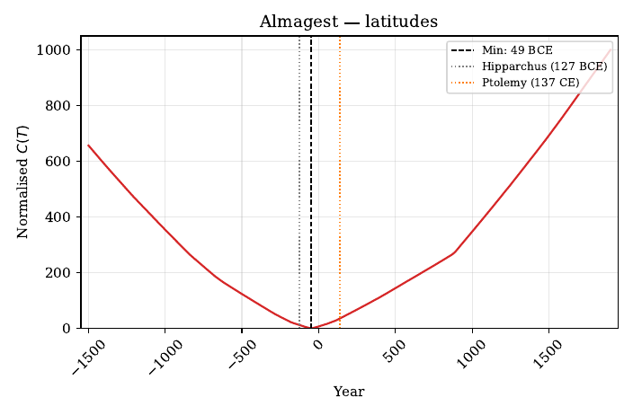
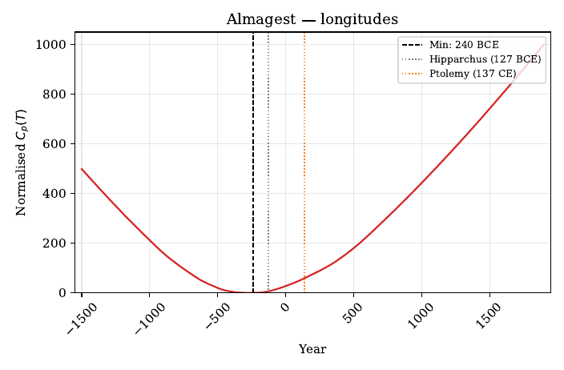
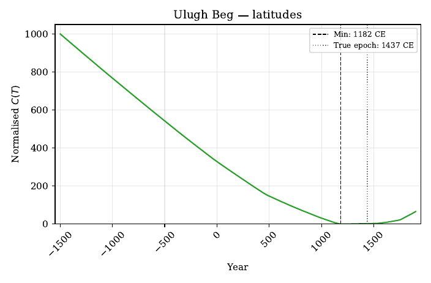
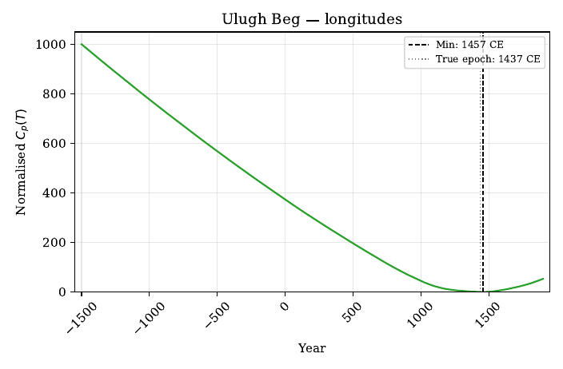
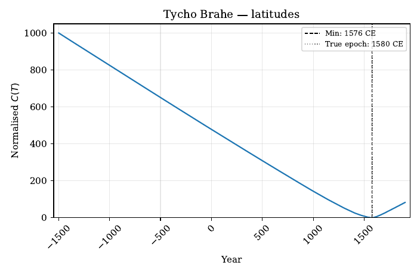
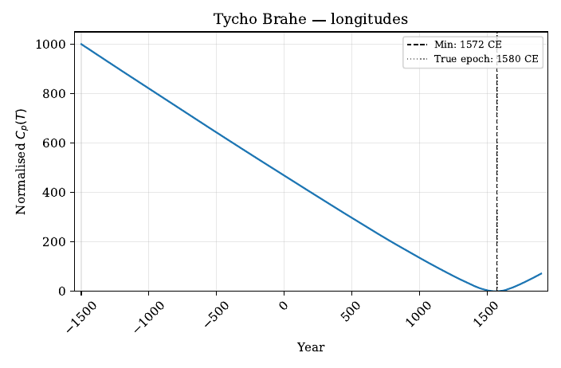

# SESCC — Speed-Error Signals Cross-Correlation

[](https://doi.org/10.5281/zenodo.19456704)
[](https://arxiv.org/abs/2604.02521)
[](https://opensource.org/licenses/MIT)

A method for dating ancient star catalogues by cross-correlating stellar
proper-motion speeds with positional residuals.

**Author:** Carlos Baiget Orts (asinfreedom@gmail.com)  

---

## Principle

A star catalogue records positions at the epoch of observation. When compared
to modern positions computed from the Hipparcos catalogue with proper motion
propagated to a trial epoch T, the residual |pos_cat − pos_mod(T)| is
minimised when T equals the true observational epoch.

At the true epoch, residuals reflect random measurement errors independent of
proper-motion speed. At any other epoch, fast-moving stars accumulate
systematically larger residuals. The SESCC statistic exploits this:

**For ecliptic latitudes (`--lat`):**

    C(T) = Σᵢ |µβᵢ| · |βᵢᶜᵃᵗ − βᵢᵐᵒᵈ(T)|

Precession does not affect ecliptic latitudes, so no correction is needed.

**For ecliptic longitudes (`--lon`, SESCC-pairs, paper Eq. 2):**

    Cₚ(T) = Σ₍ᵢ,ⱼ₎ wᵢⱼ · cos β̄ᵢⱼ · |[(λᵢᶜᵃᵗ − λⱼᶜᵃᵗ) − (λᵢᵐᵒᵈ(T) − λⱼᵐᵒᵈ(T))]±180°|
    wᵢⱼ = |µλᵢ·cosβᵢ − µλⱼ·cosβⱼ| / √(nᵢ nⱼ)

The sum runs over pairs of stars less than 15° apart. Pairwise differences
cancel any global longitude offset (including precession corrections) exactly.
The factor cos β̄ measures each residual as an arc on the sphere, because the
catalogue errors are angular, not constant in longitude; nᵢ is the number of
pairs in which star i takes part.

The epoch estimate is the T that minimises C(T) or Cₚ(T).

---

## Quick start

Ready-to-run scripts are provided for the three historical catalogues. Each
script shows the C(T) curve and reports the epoch estimate (signed years,
negative before the common era). All scripts use the same selection rule:
positional error relative to Hipparcos below 60′, no stars excluded
individually.

**Prerequisites:** catalogues must be prepared first (see
[Catalogue preparation](#catalogue-preparation)).

### Date the Almagest

```bash
bash date_almagest_lat.sh    # by ecliptic latitudes  → T = -49  (49 BCE)
bash date_almagest_lon.sh    # by ecliptic longitudes → T = -240 (240 BCE)
```



### Date Ulugh Beg (true epoch: 1437 CE)

```bash
bash date_ulugh_lat.sh       # by ecliptic latitudes  → T = 1182
bash date_ulugh_lon.sh       # by ecliptic longitudes → T = 1457
```



### Date Tycho Brahe (observations 1576–1597 CE)

```bash
bash date_brahe_lat.sh       # by ecliptic latitudes  → T = 1576
bash date_brahe_lon.sh       # by ecliptic longitudes → T = 1572
```



The latitude estimate for Ulugh Beg is displaced by a single star (Arcturus);
see the paper, Section 4.3.

---

## Catalogue preparation

Download the source data files and convert them to SESCC format before
running the dating scripts.

**Almagest and Ulugh Beg** — from Verbunt & van Gent (2012), A&A 544, A31:

```bash
# Download from CDS: https://cdsarc.cds.unistra.fr/viz-bin/cat/J/A+A/544/A31
python3 verbunt2sescc.py ptolema.dat   > catalogs/almagest_verbunt.csv
python3 verbunt2sescc.py ulughbeg.dat  > catalogs/ulughbeg_verbunt.csv
```

**Tycho Brahe** — from Verbunt & van Gent (2010), A&A 516, A28:

```bash
# Download KeplerE.dat from CDS: https://cdsarc.cds.unistra.fr/viz-bin/cat/J/A+A/516/A28
python3 verbunt2sescc_brahe.py keplere.dat > catalogs/brahe_verbunt.csv
```

Column 10 (`dist_arcmin`) of the Almagest and Ulugh Beg files, and column 8 of
the Tycho Brahe file, give the positional error used by the selection rule.
Coordinates of the Tycho Brahe file are ecliptic, equinox AD 1601.0.

Stars whose Hipparcos entry has no astrometric solution (ξ UMa, HIP 55203;
ξ Sco, HIP 78727; and HIP 115125 in Ulugh Beg) are skipped with a message.

---

## Main script: `sescc.py`

All dating is done through a single script with a `--lat` or `--lon` flag.

    cat catalog.csv | python3 sescc.py --lat [OPTIONS]
    cat catalog.csv | python3 sescc.py --lon [OPTIONS]

**Common options:**

    --bootstrap N   run N bootstrap resamples and report distribution (default 0)
    --noplot        suppress the plot

**Latitude options (`--lat`):**

    --subset N      use a random subset of N stars
    --maxmag M      exclude stars fainter than magnitude M

**Longitude options (`--lon`):**

    --sep D         pair stars less than D degrees apart on the sphere (paper: 15)
    --cosb          measure residuals as arcs (weight × cos β̄) (paper: on)
    --signed        pair weights from signed angular speeds, as in Eq. 2 (paper: on)
    --pairnorm Q    divide pair weights by (nᵢ nⱼ)^Q (default 0; paper: 0.5)
    --dlat D        rectangular window: max latitude difference (default 5.0 deg)
    --dlon D        rectangular window: max longitude difference (default 30.0 deg)
    --minvel V      min relative proper motion for a pair (default 0)
    --top N         show top N contributing pairs at minimum (default 10)

`--dlat`/`--dlon` are used only when `--sep` is not given; they reproduce the
rectangular window of v1. Without `--signed` the pair weight is
||vᵢ| − |vⱼ||, as in v1.

**Output files:**

    sescc_lat.csv               C(T) curve (latitudes)
    sescc_lon.csv               Cₚ(T) curve (longitudes)
    sescc_lat_bootstrap.csv     bootstrap distribution (if --bootstrap N)
    sescc_lon_bootstrap.csv     bootstrap distribution (if --bootstrap N)

Every run overwrites these files, so do not run several dating scripts in
parallel from the same directory.

---

## Position cache

All computed positions are cached in `sescc_positions.pkl.xz` (LZMA-compressed
pickle, included in the repository, about 9.3 million entries). If the file is
not found, positions are computed on the fly; for the Almagest this takes
about 40 minutes on a single core.

Key format:

    "{hip}_{epoch_index}_lat"   ecliptic latitude, milli-degrees (frame of date)
    "{hip}_{epoch_index}_lon"   ecliptic longitude, milli-degrees (J2000 inertial)

where `epoch_index` maps to year `1900 − epoch_index` (step = 1 year, range
1900 to −1499). Longitude entries use the J2000 inertial frame, essential
for SESCC-pairs to cancel precession exactly. Writes are atomic.

---

## Reproducing the paper (v2)

### Dating runs

| Script | Paper result |
|---|---|
| `bash date_almagest_lat.sh --bootstrap 1000` | T = −49 (bootstrap median −49, 68% [−175, +48], 76% pre-CE) |
| `bash date_almagest_lon.sh --bootstrap 1000` | T = −240 (bootstrap median −227, 68% [−421, −20], 86% pre-CE) |
| `bash date_brahe_lat.sh` | T = 1576 |
| `bash date_brahe_lon.sh --bootstrap 1000` | T = 1572 (bootstrap median 1568, 68% [1528, 1602]) |
| `bash date_ulugh_lat.sh` | T = 1182 |
| `bash date_ulugh_lon.sh --bootstrap 1000` | T = 1457 (bootstrap median 1451, 68% [1179, 1558]) |

Add `--noplot` to skip the interactive plot. The longitude scripts run
`sescc.py --lon --sep 15 --cosb --signed --pairnorm 0.5`. The v1 longitude
scripts are kept as `date_*_lon_v1.sh`.

### Synthetic calibration (paper Table 1 and Sections 5.2–5.3)

```bash
awk -F';' 'substr($1,1,1)=="#" || $10+0 < 60' catalogs/almagest_verbunt.csv > catalogs/almagest_60.csv

# Latitudes: reference epochs and the calibration at T = -49
for E in -127 137 -49; do
  python3 validate_lat_seeds.py --input catalogs/almagest_60.csv --epoch $E --seeds 2000 --noplot
done

# Longitudes: reference epochs and the calibration at T = -240
S="--input catalogs/almagest_60.csv --seeds 2000 --noise-lon 27 --noise-lat 23 --pairnorm 0.5 --sep 15 --cosb --signed --noplot"
for E in -127 137 -240; do
  python3 validate_pairs_seeds.py $S --exclude "" --angnoise --epoch $E
done

# Last row of Table 1: longitude noise constant in degrees of longitude
python3 validate_pairs_seeds.py $S --exclude "" --epoch -127
```

`--angnoise` draws the longitude noise with standard deviation σ/cos β (an
arc of σ on the sphere), as observed in the three catalogues (`check_noise.py`).
Expected results (longitude): −127 → mean −166, std 398; +137 → mean +96,
std 394; −240 → median −281, 68% [−678, +113]. The runs are independent and
can be launched in parallel.

### Sensitivity (paper Table 3)

```bash
for c in ulugh brahe almagest; do
  for opt in "--sep 15 --cosb --signed" "--sep 10 --cosb --signed" "--sep 20 --cosb --signed" \
             "--sep 30 --cosb --signed" "--dlon 30 --cosb --signed" "--sep 15 --signed" "--dlon 30 --signed"; do
    sed "s/--sep 15 --cosb --signed/$opt/" date_${c}_lon.sh > tmp.sh
    echo -n "$c [$opt]: "
    bash tmp.sh --noplot 2>&1 | grep -E "Pairs found|Minimum at" | tr '\n' ' '; echo
  done
done
rm tmp.sh
```

For the row without normalisation, replace `--pairnorm 0.5` by `--pairnorm 0`
in the scripts. Logs: `sensibilidad_v2d.log`, `pairnorm0_v2d.log`.

### Invariance to global longitude offsets

```bash
for c in almagest ulugh brahe; do
  f=$(grep -o "catalogs/[A-Za-z0-9_]*\.csv" date_${c}_lon.sh | head -1)
  python3 catalogs/generate_offset_catalogs.py $f > /dev/null
  for k in $(seq -6 6); do
    s=$k; [ $k -ge 0 ] && s="+$k"
    sed "s#$f#${f%.csv}_offset_${s}.csv#" date_${c}_lon.sh > tmp_off.sh
    echo -n "$c $s: "; bash tmp_off.sh --noplot 2>&1 | grep -E "Pairs found|Minimum at" | tr '\n' ' '; echo
  done
done
rm tmp_off.sh
```

All 13 offsets (−6° to +6°) give the same number of pairs and the same
minimum for each catalogue (`invariancia_v2d.log`).

### Figures

Each `sescc.py` run overwrites `sescc_lat.csv` / `sescc_lon.csv`, so the
figures are generated in sequence by one script:

```bash
bash figuras_v2d.sh > figuras_v2d.log 2>&1
```

It runs the six dating scripts (with `--bootstrap 1000` for the Almagest) and
`make_figures.py` after each one.

### Diagnostics

| Script | Purpose |
|---|---|
| `check_noise.py` | Robust scatter of Δλ, Δλ·cosβ and Δβ in latitude bands (paper Table 2) |
| `check_pairweights.py` | Effective weight per star in SESCC-pairs (paper Section 3.5) |
| `check_weights.py` | Effective weight per star in SESCC latitudes |
| `catalogs/check_knobel.py` | Ulugh Beg latitudes derived from Ptolemy (Knobel 1917) |
| `CRITERIO_V2.md` | How and when the pairing criterion was fixed |

### Changes from v1

- Pairs within an angular separation of 15° (`--sep 15`) instead of the
  rectangular window |Δλ| < 30°, |Δβ| < 5°; pairs that straddle the ecliptic
  pole are excluded and residuals are reduced to ±180°.
- Longitude residuals measured as arcs (`--cosb`).
- Pair weights from signed angular speeds (`--signed`), as stated in Eq. 2;
  v1 used the difference of the unsigned speeds.
- Pair weights normalised by √(nᵢ nⱼ) (`--pairnorm 0.5`).
- Uniform selection rule; the v1 scripts excluded Keid (HIP 19849) and
  α Cen (HIP 71681) in longitude.
- Synthetic longitude noise angular (`--angnoise`); 2000 realisations.
- Scan extended to T = −1499.

With these changes the calibrated uncertainty of the Almagest longitude
estimate is ±396 years (68%), and the likelihood ratio between a Hipparchan
and a Ptolemaic epoch is about 1.3. The v1 conclusion that the longitudes
discriminate between the two epochs (ratio about 17) is withdrawn.

---

## Dependencies

    pip install skyfield numpy matplotlib scipy

Skyfield downloads the DE441 ephemeris and Hipparcos catalogue automatically
on first run (~600 MB total).

---

## References

- Verbunt, F. and van Gent, R. H. (2010). A&A 516, A28. (Tycho Brahe)
- Verbunt, F. and van Gent, R. H. (2012). A&A 544, A31. (Almagest, Ulugh Beg)
- Knobel, E. B. (1917). Ulugh Beg's Catalogue of Stars. Carnegie Institution.
- ESA (1997). The Hipparcos and Tycho Catalogues. ESA SP-1200.
- Park et al. (2021). AJ 161, 105. (DE441 ephemeris)
- Rhodes, B. (2019). Skyfield. ASCL 1907.024.
